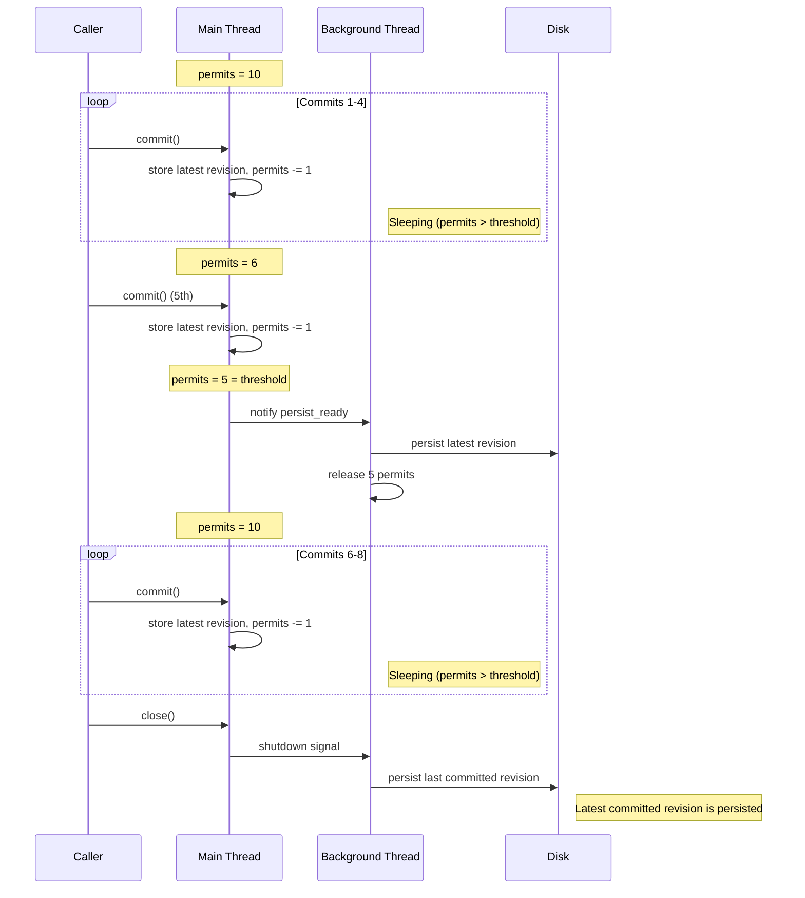

# Background Persistence

Commits do not write to disk on the caller's thread. A background thread owned
by the `PersistWorker` in the `firewood` crate persists revisions, and
`max_persistence_gap` bounds how many commits may be outstanding before it must
run. Each commit takes a permit; when the remaining permits fall to the
threshold, the background thread persists the latest revision and releases the
permits. On close, the last committed revision is always persisted.

The sequence below uses `max_persistence_gap = 10`:

