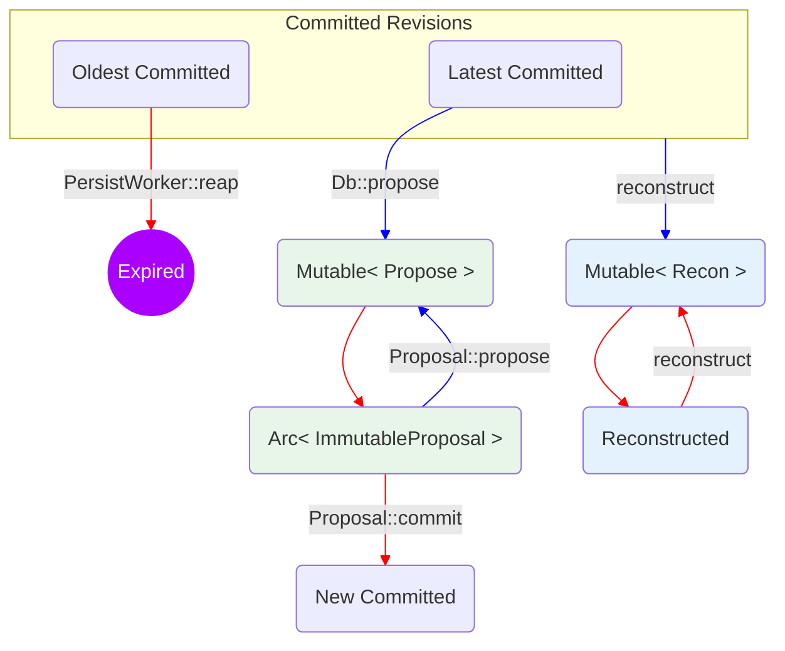

# NodeStore Lifecycle

A `NodeStore<T, S, H>` in `firewood-storage` holds one revision of the trie. The
state type `T` records what can be done with that revision:

- `Committed`: a committed revision with no in-memory changes.
- `Mutable<Propose>`: a proposal still being modified. It holds in-memory nodes,
  a delete list, and a parent.
- `Arc<ImmutableProposal>`: a proposal that has been hashed and assigned
  addresses.
- `Mutable<Recon>`: a reconstruction workspace being modified. It holds
  in-memory nodes but no delete list or parent.
- `Reconstructed`: a read-only view produced by reconstruction, which can be
  reconstructed again.

Red arrows consume their source; blue arrows borrow it.

The step-by-step proposal and reconstruction lifecycles, with links to each
conversion, are in the
[`NodeStore` rustdoc](https://ava-labs.github.io/firewood/rustdoc/firewood_storage/nodestore/struct.NodeStore.html).
