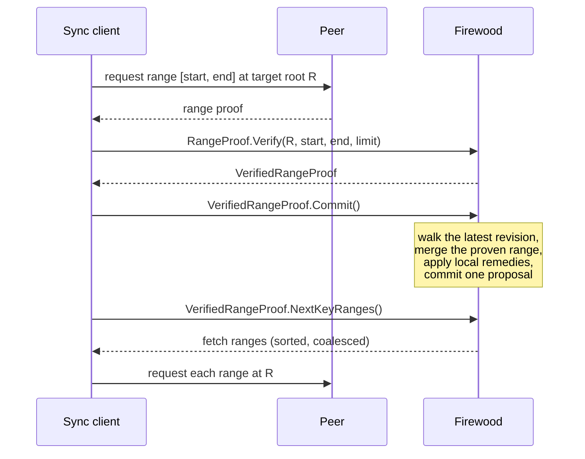

# Next Key Ranges from Post-Merge Hole Detection

## Summary

After a sync client applies a verified range or change proof, it has to decide what to
fetch next. Firewood answered with a cursor: resume just past the last proven key. That
cursor ignores most of what the proof carries. Each of the proof's two boundary proofs
holds, at every level, the hash of every sibling subtree the proven range did not
include, and each of those hashes commits to the exact target content of a known span of
key space.

This design compares every such hash against the local trie and labels the whole key
space outside the proven range:

- spans already correct;
- spans and keys the target provably lacks, which are deleted locally;
- keys whose target value the proof carries, which are written locally;
- spans that genuinely differ and must be fetched.

The verified proof's `Commit()` applies the local remedies together with the proof, and
`NextKeyRanges()` returns only the spans that still need a fetch. The cursor becomes a
work-list: an interrupted sync resumes from one proof, regions that did not change are
never fetched again, and a sync converges by construction.

The implementation is in review as a stack of pull requests, from
[#2333](https://github.com/ava-labs/firewood/pull/2333) (the prefix arithmetic) through
[#2295](https://github.com/ava-labs/firewood/pull/2295) (the FFI contract). It builds on
the verified proof types of [#2284](https://github.com/ava-labs/firewood/pull/2284).

## Motivation

A client syncing state from peers verifies a proof for a key range against a target
root, merges it, and asks where to go next. Before this design, Firewood's answer
(`find_next_key_after_range_proof` and its change-proof twin) was the byte successor of
the last proven key, paired with the requested end bound. It never inspected the proof's
sibling hashes or the local trie, and its own documentation acknowledged the gap.

A cursor that only moves forward has three costs:

- **Resuming re-fetches.** A client restarted mid-sync knows nothing about what it holds,
  so it starts the cursor over or trusts bookkeeping the database does not keep.
- **A moving target invalidates everything.** When consensus advances the target root,
  the client cannot tell which of its spans the state transition touched.
- **Divergence outside the request goes unseen.** Local content past the proven range,
  whether stale or surplus, is reported to nobody.

The boundary proofs already hold the answer. A range proof for `[start, end]` carries two
root-to-leaf paths, and every child slot on those paths that the range does not cover is
a sealed sibling hash: an authenticated commitment to the target's content under that
child's prefix. On a database of 10⁸ random keys a boundary proof carries roughly 94
populated sibling hashes, against a structural ceiling of `(16 − 1) × depth`. Path
compression authenticates further spans as empty, so the number of spans classified is
larger still. Comparing each commitment with the canonical hash of the local content
under the same prefix classifies the entire outside key space at no network cost.

Matching a sibling hash is a verification, not a heuristic. It authenticates the span's
whole content against the target root with the same strength as a range proof over that
span. A matched span never needs fetching while that root is the target.

## Guide-level explanation

### Labels

The walk emits one label per span or key it classifies. A span is named by a nibble
prefix and covers every key carrying that prefix. A point is one exact key.

| Label | Meaning | Remedy | Network cost |
| --- | --- | --- | --- |
| `Synced(span)` | Local content equals the target's | None; never re-fetch at this root | None |
| (silent) | Both sides are empty under the span, or hold the same value at a probed key | None | None |
| `Surplus(span)` | The target is provably empty; the local trie is not | Delete the span locally | None |
| `PointSurplus { key }` | The target provably lacks the key; the local trie has it | Delete the key | None |
| `PointFix { key, value }` | The target's value differs and the proof carries it | Write the value | None |
| `Missing(span)` | The target has content; the local trie has none | Fetch | One request |
| `Stale(span)` | Both sides have content and it differs | Fetch | One request |
| `PointStale { key }` | The target's value differs and the proof carries only its hash | Fetch | One request |

Only the three fetch labels cost a round trip. A client that treated every label as a
fetch would still converge, but it would spend requests on spans a local deletion fixes
and re-download values the proof already handed it.

### A worked example

Take a target holding the keys `0x10` and `0x28` and a local trie holding `0x10`,
`0x26`, and `0x28`. A client requests the range `[0x00, 0x25]`. The proof returns the
key-value pair for `0x10`, and its end proof ends at the target's next key, `0x28`. The
merge writes the proven range, which ends at `0x25`.

Above the proven range, the walk labels the open interval `(0x25, 0x28)` empty in the
target, because the proof shows nothing between the last proven key and `0x28`. So local
`0x26` is `Surplus` and is deleted. `0x28` is a key the proof carries in full, and the
local value matches it, so it is silent. Everything above `0x28` is compared through the
end proof's sibling hashes. A client using the old cursor would have resumed at `0x1000`, just
past `0x10`, fetched `0x28` again, and never learned that `0x26` should not exist.

### The sync loop

The sync client drives three calls per proof: verify, commit, and ask what is left.



An empty `NextKeyRanges()` means nothing remains to fetch. A loop over it reaches the
target root unless something else commits to the database in between (see
[The FFI and Go contract](#the-ffi-and-go-contract)).

## Detailed design

### Vocabulary

The types live in `firewood::proofs` and are re-exported at the crate root, along with
`firewood-storage`'s `Children`, which `DeletePrefixes::PerNibble` carries, and
`PathComponent`, which indexes it, so a caller matching on it needs no direct
`firewood-storage` dependency.

```rust
/// All keys carrying a nibble prefix.
pub struct KeySpan { prefix: PathBuf }

impl KeySpan {
    /// Half-open byte-key range `[lower, upper)` covering exactly this span.
    pub fn as_key_range(&self) -> (Box<[u8]>, Option<Box<[u8]>>);
    /// The byte prefixes whose union is exactly this span.
    pub fn delete_prefixes(&self) -> DeletePrefixes;
}

/// The byte prefixes covering a span, shaped by the parity of its nibble prefix.
pub enum DeletePrefixes {
    /// An even-length nibble prefix packs to one byte prefix.
    Whole(Box<[u8]>),
    /// An odd-length nibble prefix needs one completion per nibble.
    PerNibble(Children<Box<[u8]>>),
}

/// One classified span or point outside a proven range.
pub enum Hole {
    Missing(KeySpan),
    Stale(KeySpan),
    Surplus(KeySpan),
    Synced(KeySpan),
    PointFix { key: Box<[u8]>, value: Box<[u8]> },
    PointStale { key: Box<[u8]> },
    PointSurplus { key: Box<[u8]> },
}
```

**Span bounds.** `as_key_range`'s lower bound is the smallest byte key carrying the
prefix: the packed prefix when its length is even, zero-padded when odd. The upper bound
is the packed `prefix_upper_bound` (from `firewood-storage`), zero-padded the same way.
That function increments the rightmost nibble below `F` and drops everything after it,
so `A77FFF` becomes `A78`. An empty or all-`F` prefix has no upper bound and is
unbounded above. This is not `lex_successor`, which appends a zero byte: for the prefix
`AB` it gives `AB00`, which still lies inside the span.

**Why the crate owns span deletion.** Firewood's write API deletes by byte prefix
(`BatchOp::DeleteRange`), and a sealed sibling sits one nibble below its parent, so
odd-length spans are routine. Under the Ethereum mode, an account's storage children sit
at 65 nibbles. An odd-length nibble prefix has no byte-prefix form, and `as_key_range`
cannot recover it: an odd prefix `p` has the lower bound `pack(p ‖ 0)`, the same bytes as
the even prefix `p ‖ 0`. So the conversion has to live with the span representation.
`delete_prefixes` returns one byte prefix for an even span and sixteen for an odd one. Its
test checks that their union equals `as_key_range`'s interval over every key of up to two
bytes. The empty prefix converts to an empty `DeleteRange` prefix, "delete everything",
and the walk can never emit it (see [Boundary keys](#boundary-keys)).

**`Hole` is a closed enum.** Its contract is "apply every remedy you receive or your
state diverges", so adding a label has to break every `match`. With `#[non_exhaustive]`,
every external match would carry a wildcard arm, and a new label would surface as an
unexplained root-hash mismatch in production rather than a build failure. A
`{ extent, verdict }` grid was also rejected: it can represent a span carrying a single
value, which is meaningless.

### Verified proof types

The walk takes a proof and the verification context it produced as one value, so a
caller cannot hand in proof A next to proof B's context.

```rust
impl VerifiedRangeProof {
    pub fn verify(
        proof: impl Into<Arc<FrozenRangeProof>>,
        root: HashKey,
        start_key: Option<&[u8]>,
        end_key: Option<&[u8]>,
        algorithm: NodeHashAlgorithm,
        max_length: Option<NonZeroUsize>,
    ) -> Result<Self, api::Error>;
    pub fn proof(&self) -> &Arc<FrozenRangeProof>;
    pub fn verification(&self) -> &RangeProofVerificationContext;
}
// `VerifiedChangeProof` mirrors this over the change-proof structure verifier.
```

`verify` is the only constructor, and it takes the structure verifier's own parameters.
The proof is held behind an `Arc` because the FFI keeps the unverified proof usable after
verifying it, and an owned proof would clone its body on every verify. The type is not
`Clone`; the body is shared through `proof()`.

### The coverage contract

The walk's obligation is stated over a named set, and the tests check it against that
set. The **applied range** is `[start_key, right_edge_key]` from the verification
context. A range-proof merge has to be bounded to the proven range, so a caller that
merges over the requested bounds instead erases local keys the proof never covered. The
applied range is therefore a function of the verified proof, not a parameter, and the
walk reads it from the context.

The obligation: every key in `[0, start_key) ∪ (right_edge_key, ∞)` falls in exactly one
emitted span, equals exactly one probed point, or lies in a silent both-empty agreement.

A per-walk statement ("the left walk partitions its side, the right walk partitions its
side") can hold while the union has a hole, such as the interval between a proven right
edge and an end-proof terminal above it (see [Boundary keys](#boundary-keys)). The tests
therefore check the global statement.

An unbounded merge deletes to the end of the trie, because the merge iterator never
stops when its last key is `None`, so `[start_key, None]` really is the applied range.

### The local probe

`subtree_hash(view, prefix)` returns the canonical hash of the local content under a
nibble prefix: the value a sealed sibling at that position would hold if the local trie
were the target. It descends with `descend_to_prefix`, a read-only walk that consumes a
nibble path one component at a time. It cannot use `path_iter`, because byte keys cannot
name odd-length positions. Four outcomes, all handled:

| Probe ends | Result |
| --- | --- |
| Diverging inside a compressed path, at an absent child slot, or past a leaf | `Ok(None)`: no local keys under the prefix |
| Exactly on a child edge | The parent's stored hash for that child |
| Inside or at the start of a node's partial path | The node re-encoded with the probe as its parent prefix and the unconsumed remainder as its partial path |
| Through or at a child held in memory without a hash | `Err(api::Error::UnhashedView)` |

**Re-encoding mid-edge.** A probe that lands inside a compressed edge must not use the
node's stored hash, which commits to a longer partial path than the content under the
probe has. A local trie holding only `0xA711` stores one leaf with partial path
`[A,7,1,1]`. Probing `[A,7,1]` must return the hash of a leaf with partial path `[1]`,
not the stored hash. The re-encoding goes through `HashableShunt` under the database's
`HashMode`. Under MerkleDB hashing the preimage is the full path, so the adjusted split
reproduces the stored hash and the case is invisible. Under the Ethereum mode the partial
path itself is hashed, so the re-encoding produces a different hash, and the tests check
both that it differs and that it matches the target's sibling hash.

**Never fold "unknown" into "empty".** A consumer reads `None` as "the target has keys
here and the local trie has none", or as "nothing to delete", and either reading over an
unhashed or unreadable subtree orders the wrong remedy, including deletion of correct
data. `BranchNode::children_hashes()` silently reports an unhashed `Child::Node` as an
absent child, so the probe checks for that variant explicitly. Node reads propagate their
I/O errors, the root read included.

**Reconstructed views are a live case.** A reconstructed view hashes its root lazily:
until `root_hash()` is called, its children are `Child::Node`. Reconstructed views are
what a sync client holds, so both entry points call `view.root_hash()` before probing,
which swaps every in-memory child for a hashed one. The error arm stays for anything the
pre-call misses, and it is the only check that exists in release builds.

**Depth.** The descent and the walk are loops, not recursion, so trie depth never grows
the call stack. Key length is bounded by `MAX_KEY_BYTES`, which also bounds
`open_interval`'s output, quadratic in the bound's length.

**Hash-mode agreement.** The walk is generic over `H: HashMode`. A proof parsed under the
other mode is rejected up front with `ProofError::HashModeMismatch`, because every
comparison against it would read `Stale`.

### The walk

The walk transcribes a verified boundary proof from its root down, for a boundary key
`κ` and a side (`Below` for the start proof, `Above` for the end proof). It keeps the
number of nibbles of `κ` consumed so far, `cur`. `side(x)` is `{i : i < x}` below and
`{i : i > x}` above. `compare(u, target)` probes `subtree_hash` at `u` and labels the
pair. `point(k, value)` reconciles one exact key. `child_hash(N, i)` is the sibling hash
`N` carries for slot `i`, and "`N` re-encoded below `p[l]`" is `N` hashed with
`κ[..cur+l] ‖ p[l]` as its parent prefix and `p[l+1..]` as its partial path: the target's
commitment to a subtree the proof holds in full.

```text
for each proof node N, root first:
    p := N's partial path at the walk's position;  l := common prefix length of p and κ[cur..]

    (1) for each offset o < l, each x in side(κ[cur+o]):
            compare(κ[..cur+o] ‖ x, None)        // a compressed path implies no siblings
    (2) if Below: for each even offset cur+o < cur+l:
            point(κ[..cur+o], None)              // byte keys inside the segment

    if l < |p|:                                  // the path leaves κ inside N's partial path
        if cur+l < |κ|:                          // terminal: divergence
            for x in side(κ[cur+l]) \ {p[l]}: compare(κ[..cur+l] ‖ x, None)
            if p[l] in side(κ[cur+l]): compare(κ[..cur+l] ‖ p[l], hash(N re-encoded below p[l]))
            if Below and cur+l is even: point(κ[..cur+l], None)
            compare(κ[..cur+l+1], None)          // κ's own continuation is empty
        else if Above:                           // terminal: κ ends inside the partial path
            compare(κ ‖ p[l], hash(N re-encoded below p[l]))
            for x ≠ p[l]: compare(κ ‖ x, None)
        stop

    cur += l
    (3) if Below and cur < |κ| and cur is even:
            point(κ[..cur], value carried by N)  // the node's own key, a prefix of κ
    if cur = |κ|:                                // terminal: κ ends at N
        if Above: for each slot i: compare(κ ‖ i, child_hash(N, i))
        stop
    (4) for i in side(κ[cur]): compare(κ[..cur] ‖ i, child_hash(N, i))
    if child_hash(N, κ[cur]) is empty:           // terminal: absent slot
        compare(κ[..cur+1], None);  stop
    cur += 1
```

`compare` labels the pair `(target, local)`: `(None, None)` is silent,
`(None, Some)` is `Surplus`, `(Some, None)` is `Missing`, equal hashes are `Synced`, and
unequal hashes are `Stale`.

**Structure comes from the node's key.** The walk takes each node's partial path from
`ProofNode::key` at its own position, not from `partial_len`. MerkleDB hashing commits to
a node's full path but not to where it splits, so a proof with a tampered `partial_len`
still verifies under MerkleDB; a test checks that such a proof yields the honest labels.
Under the Ethereum mode both are authenticated.

**Point probes under byte keys.** Firewood keys are byte strings, so only even nibble
offsets name a key, and the walk probes only those. Probes run only below the start key:
above the end key, the proper prefixes of the boundary key sort below it. Under the
Ethereum mode they are real, since an account key is a proper prefix of its storage keys.
A point compares the target's value digest with the local value under the hasher's own
rule. MerkleDB hashing stores values of 32 bytes or more as their hash, so a differing
value known only by its hash is `PointStale` and a differing value carried in full is
`PointFix`.

**Lemma (coverage).** In a completed walk the emitted spans are pairwise incomparable,
the probed points lie on `κ`'s prefix chain inside no emitted span, and every key
strictly on the walked side of `κ` lies in exactly one emitted span or equals exactly one
probed point.

*Sketch.* Take a key `k` strictly on the walked side. Either `k` is a proper prefix of
`κ`, which is possible only below, and sources (2) and (3) probe every byte-aligned
prefix up to the terminal. Or `k` first differs from `κ` at some offset inside the walked
path, and the span at that offset with nibble `k[o]` was emitted by (1), (4), or a
terminal. Or `k` diverges past the terminal or extends `κ`, and it lies in exactly one
terminal span. Spans emitted at different offsets leave `κ`'s path at those offsets, so
none is a prefix of another; spans at one offset carry distinct nibbles.

### Boundary keys

**Below.** The boundary key is the verification context's start key. There is nothing to
walk when the start key is `None`. When the start key is set but the start proof is
empty, the walk emits nothing below it, on both proof kinds:

- **Range proofs.** The verifier accepts an empty start proof with a start key. It adopts
  the values an end-proof path node carries, and it checks a node's value against the
  key-value pairs only when the node's key is in range. A value below the start key on
  the end-proof path is therefore accepted without ever appearing in the key-value
  pairs, and a root match says nothing about `[0, start)`. Labeling that region
  `Surplus` would order the deletion of target keys.
- **Change proofs.** Root verification forks the caller's proposal into the proving trie
  and substitutes proof-supplied sibling hashes only where boundary nodes produce a mask.
  An empty start proof produces none, so the left portion of the computed hash comes from
  the proposal's own content. Content hanging off end-proof nodes is authenticated as
  equal, not empty. Content under an intermediate branch the end trie lacks is stripped
  from the computation and authenticated as nothing. `Surplus` would delete data the
  verifier just proved correct, and `Synced` would over-claim, so silence is the correct
  label rather than a conservative placeholder. Changing it would need a verifier change.

**Above, range proofs.** The walk recomputes the end proof's right boundary with the same
classifier the verifier uses (`right_edge`), and checks that reducing it the verifier's
way reproduces the context's `right_edge_key`. The owning type makes a swapped context
unconstructible, so a disagreement can only mean the walk and the verifier have drifted
apart, and it is reported as `api::Error::InternalError`.

- `InRange(None)`: the applied range runs to the end of the key space, and there is
  nothing above it. An empty end proof always lands here, which is why the "delete the
  whole database" span is structurally unreachable, not merely guarded.
- `InRange(Some(end))`: walk the end proof for `end`, side `Above`.
- `OutOfRange(k)`: the end proof's terminal is a real target key `k` above the proven
  edge. The merge stops at the edge, so the walk handles three pieces:
  - the open interval `(right_edge_key, k)`, decomposed with `open_interval` and labeled
    against no target content, since the proof shows it empty;
  - `k` itself, as a point with the value the terminal carries;
  - everything above `k`, through the end-proof walk.

  This is the worked example's case. Without the interval decomposition, local `0x26` is
  covered by no label, can never be deleted, and the sync never converges while
  reporting nothing to fetch.

**Above, change proofs.** The boundary key is the context's `right_edge_key`, the key the
verifier verified the end proof at. The change-proof context stores that anchor itself,
not a reduced bound, so there is no `OutOfRange` analogue. The verifier sets a right edge
only with a non-empty end proof; with no right edge, nothing is walked above.

`open_interval(lower, upper)` splits the open interval between two nibble paths into
pairwise-incomparable prefix spans plus points. The points are the byte keys that are
proper prefixes of the upper bound: they sort inside the interval but lie under no prefix
that excludes the bound. A test checks the decomposition against every key of up to two
bytes.

### Overlaps

The terminal spans of a divergence or an absent slot contain the boundary key, so they
can straddle the applied range, and the left walk's and right walk's terminal spans can
contain the same key. Such a span is empty in the target over its whole extent: it is an
absent child slot of a verified node, or absence implied by a verified node's path
compression. Deleting anything in it is sound, including inside the applied range, and
it cannot remove a key the merge wrote.

Clipping the spans to the outside of the applied range was rejected: a clipped prefix
span is no longer a prefix, and `KeySpan`, `as_key_range`, and `delete_prefixes` all
depend on spans being prefixes. Instead `merge_labels` sorts every label by its lowest
key and checks that labels overlap only when both are deletions. Redundant deletes are
idempotent, so remedy order does not matter. A deletion overlapping any other label
would contradict itself under one root: `Surplus` over `Synced` would assert the same
span both empty and matching. Honest verified proofs cannot produce it, so the check
returns `api::Error::InternalError` and names both labels.

### The Ethereum mode

Two Ethereum-mode properties make some local and target commitments differ even when the
content agrees. The walk handles both.

**Account values are compared with `storageRoot` masked.** An account value's third RLP
field is the root of the account's storage trie, and hashing derives it from the storage
children rather than trusting the stored bytes. A `PointFix` for a `storageRoot`-only
difference would write a value that hashing immediately rewrites, and every later walk
would emit the same label. The storage difference that field stands for is already
reported by the span labels at and below the account. So `values_agree` compares the
values at 32-byte keys with the field zeroed on both sides, and falls back to a plain
comparison when either side is not well-formed account RLP. A point label at an account
key therefore means the nonce, balance, code hash, or a trailing field differs.

Databases written before `firewood-v1-hfix` store account values with a stale
`storageRoot`. Proofs repair the field and the local read does not, so without the mask
every such account would read `PointFix`. The hasher splices the derived field into the
account preimage on any database version, so subtree hashes are unaffected, and the walk
needs no repair site and no header check. A test reopens a store with a pre-hfix header
and clobbered account values and checks that it walks exactly as the current store does.

**A lone storage child is hashed under the target's convention.** When an account has
exactly one storage child, live hashing stores that child's hash folded as a standalone
storage-trie root, and proof nodes copy stored child hashes. The same storage content
therefore hashes differently under a one-child account and a many-child one. When a
boundary runs through an account (at 64 nibbles) and the two sides fold its depth-65
slots differently, the walk reads the local shape at the account position once. It then
re-hashes each shared depth-65 slot under the target's convention before comparing:
folded through `hash_node_as_storage_trie_root_parts`, or unfolded as an ordinary child.
The local shape is one of two kinds:

- **An account branch.** It folds its slot when it has exactly one child. The probe finds
  it however many branches sit above it: `descend_to_node`, unlike `descend_to_prefix`,
  reads the child behind a child edge and reports it as the node at the position. This
  matters when a sibling account shares 63 nibbles, which puts a branch at depth 63, or
  62 nibbles, which leaves the depth-63 branch an empty partial path.
- **A compressed one-slot subtree.** A local trie can hold an account's storage slot but
  not the account value. A client whose earlier merge stopped short of the account key,
  which sorts before its storage, lands here. Then no node sits at depth 64; one node's
  partial path runs through it and stores its slot unfolded.

The target has the mirror shapes. A boundary proof node at depth 64 folds when it has
one child. A proof node whose partial path runs through depth 64 holds its slot unfolded,
and the walk re-hashes the local slot unfolded to match it.

This is the one place the walk reads local branch structure rather than a probe result.
Tolerating the false `Stale` was rejected: it converges only if the caller applies the
paired `Surplus` deletion before walking again, and fetching without deleting re-emits
the same label forever. It would also put an exception into the public contract and the
test oracle. A wrong re-hash yields a false `Stale`, never a false `Synced`, so the
normalization cannot make the walk less sound.

### Applying labels

Two functions turn labels into actions, both in `firewood::proofs`:

- `remedy_ops(&[Hole]) -> Vec<OwnedBatchOp>` builds the local remedies:
  - `DeleteRange` over `delete_prefixes()` for `Surplus`;
  - `Delete` for `PointSurplus`;
  - `Put` of the carried value for `PointFix`.
- `fetch_ranges(&[Hole]) -> Vec<KeyRange>` packs `Missing`, `Stale`, and `PointStale`
  into sorted key ranges, coalescing adjacent ones so a run of holes costs one request.

A `KeyRange` is inclusive at both ends, matching the request bounds range proofs take. A
prefix span has no exact inclusive upper bound, since its largest key is unbounded in
length. So a range's end is its last label's exclusive bound used as an inclusive one,
which over-covers by exactly one key: the first key of whatever follows. The extra key
is harmless. A reply over the range carries the target's verified content for it, so
merging it rewrites an equal key equal and deletes a key the target lacks, which is what
the neighboring label called for anyway. A point's bound is its byte successor. Only
adjacent ranges coalesce, so labels from separate walks that overlap produce overlapping
ranges, never a shortened one.

### Library surface

The public entry points are methods on the erased view handles that `firewood::open`
callers already hold:

```rust
impl CommittedView {
    pub fn find_holes_after_range_proof(&self, verified: &VerifiedRangeProof)
        -> Result<Vec<Hole>, api::Error>;
    pub fn find_holes_after_change_proof(&self, verified: &VerifiedChangeProof)
        -> Result<Vec<Hole>, api::Error>;
}
// `ReconstructedView` exposes the same two methods.
```

The views hold an erased nodestore. A crate-private `DynHoleFinder` trait, a supertrait of
the existing erased-view traits, carries the capability, and its blanket impls recover
`H` for the generic walk, so no caller names the hash mode. `DynDbView` is unchanged.
`merkle::Merkle` is crate-private, so the generic walk takes `T: HashedNodeReader` rather
than `&Merkle<T>`. Only hashed stores satisfy that bound, which keeps mid-mutation
proposals out.

Applying a verified proof with its remedies is one call per proof kind:

```rust
impl<H: HashMode> Db<H> {
    pub fn apply_verified_range_proof(&self, verified: &VerifiedRangeProof)
        -> Result<(Proposal<'_, H>, Vec<Hole>), api::Error>;
    pub fn apply_verified_change_proof(&self, verified: &VerifiedChangeProof)
        -> Result<(Proposal<'_, H>, Vec<Hole>), api::Error>;
    pub fn current_committed_view(&self) -> CommittedView;
}
// `DynDb` mirrors all three.
```

Each apply walks the latest revision and builds one proposal on it, containing the
proof's content (the range merge, or the change proof's operations) followed by
`remedy_ops` of the walk's labels. It returns the labels with the proposal.

- **The walk sees the right state before the merge.** The merge replaces content only
  inside the applied range, so the outside space the walk classifies is the same before
  and after. The parent walk can also report `Surplus` or `PointSurplus` over local keys
  inside the applied range, which the merge deletes anyway.
- **The change-proof root check still holds with remedies in the proposal.** It hashes
  only the proposal's in-range content. Everything strictly outside the applied range is
  either masked behind the proof's own sibling hash or stripped while collapsing
  branches, whatever the local fork holds there. The one unmasked shape, an empty start
  proof with a start key, is the case where the walk emits nothing.
- **`current_committed_view` takes the latest revision without a root hash.** An empty
  MerkleDB database has no root hash, which is the ordinary first step of a sync, and
  resolving a hash and then opening that revision races a concurrent commit.

The merge is collected into an owned batch so the remedies can follow it. The merge
iterator reports no size hint, while the collected batch reports its exact length, so a
merge plus remedies of eight or more operations takes the parallel proposal path under the
default `UseParallel::BatchSize(8)`, as change proofs do. That path accepts `DeleteRange`
and `Put` operations in any order.

The `find_next_key_after_*` pair is removed; it takes no view and cannot produce the
work-list.

### The FFI and Go contract

The Go verified proof types (`VerifiedRangeProof`, `VerifiedChangeProof`) carry the
contract.

**`Commit()` brings the database into agreement with the target everywhere the proof
speaks**: inside the applied range by replacement, as before, and outside it by the
walk's local remedies. It is one proposal and one commit. What the proof cannot settle is
what `NextKeyRanges()` reports.

- **Range proofs build their proposal at `Commit()`, not at `Verify()`.** Checking a range
  proof needs only the root and the hash mode. The sync client runs several workers
  committing to one database, so a proposal built at `Verify()` would usually be stale by
  `Commit()`. In C, a commit that lands during the merge makes
  `fwd_verified_range_proof_commit` return `ParentNotLatest`, and the next call builds
  again. The Go wrapper holds the database's commit lock for the whole call, so the merge
  instead blocks `Update`, `Propose`, and other commits while it runs. The merge writes
  the proof's key-value pairs, bounded by the request's limit, and deletes every local key
  in the proven range the proof lacks, which the limit does not bound. The hold is that
  merge plus one walk and the commit.
- **Change proofs build their proposal at `Verify()`.** Checking a change proof's end
  root needs the applied proposal, so `Verify()` walks the latest revision, builds the
  proposal with its remedies, and checks the root. A verified change proof holds that
  proposal until `Commit()` or `Drop()`.
- **Change proofs re-apply on a stale parent.** If the database advanced since `Verify()`,
  `Commit()` applies the proof again to the latest revision, walk included, and re-checks
  the root against the verified end root. The structural pass is not repeated, since its
  result does not depend on the revision. Content written in between that the target
  does not hold is deleted too.
- A second `Commit()` returns the cached root without touching the database.

**`NextKeyRanges()` always describes the latest committed revision.** After a commit, the
fetch ranges from the commit's own walk are returned only while the database's root is
still the one that commit produced. At the verified root, nothing remains. Otherwise,
before any commit or once something else has committed, the walk runs again against
`current_committed_view()`. Reading the root and then the view is two steps, so a commit
can land between them; the walk then describes the newer revision, which is still the
latest, and the root comparison was only a shortcut. In the one call pattern that exists (commit, then next key,
nothing in between) the walk runs once. Ranges are sorted, coalesced, and inclusive, and
are not clipped to the request: they can lie below its start key or above its end key.

An empty result means nothing remains to fetch, not that the database is at the target
root. Content the database holds and the target lacks, or holds with a value the proof
carries, is not reported, because `Commit()` deletes or writes it. Once that commit has
landed, a later commit that brings such content back is neither repaired nor reported. A
caller that needs to know it reached the target compares the database's root with the
target root.

**A Go proof belongs to the database that generated or parsed it.** `Verify()` takes no
database: it checks the proof against its own database, under that database's hash mode,
and `Commit()` applies it there. To use a proof on another database, marshal it and
unmarshal it there, the same path it takes over the network. The Rust verified types are
not bound to a database, and `Db::apply_verified_*` accepts one verified elsewhere if its
hash mode matches; nothing prevents that, but no Go API offers it.

**Concurrent sync.** AvalancheGo never runs state sync and block acceptance at the same
time, but its syncer commits proofs from several concurrent work items over disjoint
ranges of one target root. Keys another worker wrote from a proof of the same root are
target content, so no remedy deletes them: inside another worker's range the walk sees
either matching or partially written content, which reads `Synced`, `Missing`, or
`Stale`, never `Surplus`. After the syncer moves its target root, a proof for the old
root can delete keys written for the new one. A later walk reports them as fetch ranges,
so the sync still converges, at the cost of a refetch.

### Errors and contracts

- No panics and no mutation. The walk returns labels; applying them is the caller's job,
  or `apply_verified_*`'s.
- `ProofError::HashModeMismatch` for a proof parsed under the other mode.
- `api::Error::UnhashedView` and propagated I/O errors from the local probes.
- `api::Error::InternalError` when the walk's own invariants fail: the recomputed right
  edge disagrees with the context, a verified proof ends without a terminal, or an overlap
  check fails.
- The local trie is assumed canonical and is not checked. A non-canonical trie, which a
  reconstructed view can be, can only manufacture holes, never hide them. A test checks
  that the walk then never orders the deletion of a key the target holds, and that one
  round of remedies on a canonical store converges.
- Labels authorize remedies against the revision walked, or a proposal built directly on
  it. Applying them on top of a later revision voids the authorization.

### Invariants

The test program exists to falsify these.

1. Every key outside the applied range falls in exactly one emitted span, equals exactly
   one probed point, or lies in a silent both-empty agreement. Checked globally, never per
   walk.
2. A span may extend into the applied range only if the target is empty under it.
3. Labels overlap only when both are deletions.
4. Every label is applicable through `BatchOp` alone, with the conversion owned by the
   crate that owns the span representation.
5. No label depends on an account value's `storageRoot` or on the header's repair flag.
6. No emission orders the deletion of content authenticated as equal.
7. `subtree_hash` handles all four outcomes, and a child held without a hash is an error,
   not "no local keys".
8. `NextKeyRanges()` describes the latest committed revision.

## Evaluation

### Soundness

Let a boundary proof for `κ` be verified against a root committing a target map `M`, and
let the local map `L` be canonical. Then:

1. **Coverage.** The walk classifies the whole key space on its side of `κ`, by the
   coverage lemma.
2. **Sound skips.** Unless a hash collision can be extracted, every `Synced` span and
   every silent agreement has `L ∩ span = M ∩ span`, and every applied `PointFix` sets
   the target's value. Both comparands are canonical hashes of their content: the target
   side because sibling hashes are child hashes of the canonical target trie, and
   terminal re-encodings are injective encodings of verified nodes; the local side by
   `subtree_hash`'s construction. Equal hashes over different content would be a
   collision.
3. **True holes.** Every `Missing`, `Stale`, `Surplus`, or `PointSurplus` marks a real
   difference, and a `Surplus` span is empty in the target, so local deletion alone
   repairs it. Equal content has equal canonical hashes, so a mismatch means different
   content. This direction needs no collision assumption, but it does need `L` canonical.
4. **Granularity.** Nothing finer is decidable from the proof. Which keys inside a
   `Stale` or `Missing` span differ is hidden behind the sibling hash.

**Change proofs.** The same argument holds for the sibling hashes a change proof's
boundary proofs carry, because the change-proof verifier checks both boundary proofs
against the end root exactly as the range-proof verifier does. What differs is the root
check itself: it hashes the proposal, substituting the proof's sibling hashes where the
boundary nodes supply them and the proposal's own content elsewhere. The walk therefore
labels only from boundary proofs that exist. Below an empty start proof, the only place
the root check reads the proposal's own content outside the applied range, it emits
nothing (see [Boundary keys](#boundary-keys)).

The failure that matters is therefore one-directional. A false match would be a
collision, so every mistake on the local side manufactures a hole. The symptom is a sync
loop that fetches a span, verifies and applies it, and finds the identical hole on the
next pass: a livelock, not a fault, and invisible to tests that only check labels. The
mid-edge re-encoding, the `storageRoot` mask, and the fold normalization each close one
such livelock, and the tests below check convergence directly.

### Tests

The tests run under both hash modes in one build through `#[hash_mode]`, except the
Ethereum account fixtures, which use 32-byte keys and are meaningless under MerkleDB.

- **A flat-map oracle.** Every emitted label is recomputed from the target and local maps,
  account values masked as the walk masks them, and every key outside the applied range
  must be covered exactly once. Keys covered by more than one label are allowed only when
  every covering label is a deletion: the start and end boundaries' terminal spans can
  both contain a key the target proves empty.
- **Named scenarios.** Missing, stale, synced, and surplus spans; a probe inside a
  compressed edge; prefix-key values that are surplus, repairable, or known only by hash;
  straddling terminals; an end key ending inside a compressed edge; the out-of-range
  interval; a tampered `partial_len`; a proof under the other hash mode; and a fully
  synced pair, which must yield only `Synced` labels and silence.
- **Ethereum fixtures.** Masked account comparisons and the legacy header. The fold is
  tested in every shape above, and each fold test applies its remedies through `Db` and
  walks again.
- **Reconstructed views.** A view with an unhashed child walks once its root is hashed,
  and a non-canonical view manufactures `Stale` without ever ordering a wrong deletion.
- **A differential fuzz** (`test_slow_holes_differential_fuzz`). It builds a random
  target, derives a local map by dropping, altering, and adding keys, and under the
  Ethereum mode plants accounts with one or two storage children so the fold straddles
  often. It then verifies a random range proof, merges, and walks. The oracle checks
  every label; then every label is applied through the public write API (deletion
  geometry from the labels themselves, replacement content from the target) and a second
  walk must find only agreement. A change proof from the target with the local trie as
  source, the proof a syncing client holds, runs through the same steps. Each proof is
  also applied through `apply_verified_*` from the pre-merge state and committed.
- **Change-proof equivalence.** The range-proof and change-proof walks agree label for
  label only when they cover the same key space partitioned the same way. They do not
  when the applied ranges differ: a limit truncates either proof, an empty start proof
  silences one side, or the change proof's right edge narrows to its last operation's
  key, which always happens when the request has no end key. They also do not when the
  range proof's right boundary is out of range: the range walk decomposes the gap into
  fine spans and a point, while the change walk reports one span. Both partitions are
  correct, so the fuzz asserts equality only outside these cases, and checks that the
  comparison still fires.
- **Go.** `Commit()` deletes surplus past the proven edge, the ranges stay stable across
  the commit and an unrelated commit, and a loop following `NextKeyRanges()` reaches the
  source root, including for a bounded request with holes on both sides.

### Cost

A walk compares every populated sibling slot on its boundary path, at most
`(16 − 1) × depth`, plus the spans compressed paths imply empty. Each comparison is one
root-down descent of at most `depth` node reads and at most one hash. A trie of 10⁸
random keys reaches 7 levels, so the ceiling is 105 siblings per boundary, and with an
average branching depth of about 6.3 a random-occupancy estimate is about 94 populated
ones. Under the Ethereum mode a boundary key inside an account's
storage traverses both tries, so `depth` is closer to 12–14 and the estimate is about
200. These are estimates; the measurements below stop at 10⁵ keys.

Measured on fuzz tries of up to a few dozen keys plus up to three accounts, in a debug
build, the mean was 93 node reads per walk under MerkleDB and 261 under the Ethereum
mode, with maxima of 3,842 and 6,354 on long keys and account paths. On a 100,000-key
trie (about 107,000 nodes) with truncated proofs starting throughout the key space, a
walk reads at most about 7,000 nodes, and a release build takes about 0.2 ms per walk in
either mode. The work tracks the boundary proofs' depth, not the trie's size.
`test_slow_walk_cost_on_a_large_trie` bounds reads per walk at 20,000, about three times
the measured maximum. It counts node reads rather than time, since a busy CI runner makes
time noisy.

A walk runs on every applied proof. At these figures it is small next to the merge and
the commit, and next to the network round trip each `Synced` span saves. The measured
times are against a warm node cache; a cold cache turns each read into a disk read, and
for a range proof in Go that time is spent under the commit lock.

## Drawbacks

- **`Commit()` writes outside the proven range.** Every remedy is authenticated, but a
  caller can no longer reason about a commit's effect from the proof's range alone.
  Reversing this later is a second breaking change to the Go contract. Every node synced
  in between would hold content a range-scoped client would not have produced: correct
  content, but content a downgraded client would have to re-derive by refetching. Both
  kinds of client reach the same content once a sync completes; they differ only along the
  way. An opt-in flag for range-scoped commits can be added if a second consumer needs
  one.
- **Every applied proof pays for a walk**, even when the caller never asks for next key
  ranges.
- **The merge is held in memory.** Collecting it into an owned batch materializes every
  write and every in-range deletion before the proposal is built.
- **Odd-length span deletion costs sixteen `DeleteRange` operations**, one per nibble,
  until a bounded range deletion exists in the write API.
- **The local trie is trusted to be canonical.** A non-canonical trie, which a
  reconstructed view can be, manufactures `Stale` spans that a sync keeps fetching until
  the trie is rebuilt canonically. The walk does not detect it.
- **An empty start proof leaves its region unclassified.** That is correct for what the
  verifier authenticates, but the space below the start key stays unknown until another
  proof covers it.
- **Fetch ranges over-cover by one key each.** Harmless for correctness, slightly wasteful
  for bandwidth.
- **Breaking changes.** `DynDb` gains required methods and is not sealed, so an external
  implementation must add them. `apply_verified_change_proof` changes its return type, and
  the `find_next_key_after_*` pair is removed. The C and Go signatures do not change, but
  their contracts do: `Commit()` writes and deletes outside the proven range, and
  `NextKeyRanges()` can return several ranges anywhere in the key space, with a start key
  that is no longer the successor of the last proven key.

## Rationale and alternatives

- **Emit the work-list from verification.** Range-proof root verification already
  computes the masks of outside children. Rejected: verification runs before the merge,
  against the proving trie, while hole detection needs the local trie after it. The
  sibling inventory would have to be kept and compared later anyway, coupled to the
  subtlest code in the verifier, and the three-phase change-proof verifier fits it poorly.
- **A lockstep diff walk.** Descending the proof and the local trie together amortizes
  each probe to a constant. Deferred: at the probe counts above it is not needed, and its
  interleaved mid-edge and terminal cases are the hardest variant to review. It can
  replace the internals later behind the same API.
- **Clip straddling spans.** Rejected; see [Overlaps](#overlaps).
- **Pass the applied range explicitly.** Rejected: it is a function of the verified proof.
  A parameter would either duplicate two context fields and need a cross-check against
  them, or admit a disagreement the design would then have to define.
- **Pair proof and context by convention, or check `root` inside the walk.** Rejected for
  the owning type, which makes a mismatch unconstructible. A check inside the walk cannot
  catch a context from a different proof against the same root.
- **Leave span deletion to the caller.** Rejected: an odd-length span cannot be rebuilt
  from its byte range, and the fallback is a local scan of a span that may be a large
  fraction of the database.
- **Tolerate the fold's false `Stale`.** Rejected; see [The Ethereum mode](#the-ethereum-mode).
- **Suppress account point probes.** Rejected: the account node sits on the boundary path,
  so its value is checked only by that probe, and a nonce-only change would go unlabeled.
  The mask removes exactly the derived field.
- **`Synced` below an empty change-proof start proof.** Rejected: content under collapsed
  intermediate branches is not authenticated. See [Boundary keys](#boundary-keys).
- **A separate `ApplyRemedies()`, or an opt-in `CommitWithRemedies()`.** Rejected: the
  only consumer runs verify, commit, and next key together, so a separate call means two
  commits and two walks per proof and halves the revision window a sync loop has. There is
  no second consumer to justify the extra API.
- **Resolve the root hash, then open that revision.** Rejected for
  `current_committed_view`: an empty MerkleDB database has no root hash, and a commit
  between the two calls can age the revision out of the revision window.
- **Exclusive range ends.** Rejected: a prefix span still has no exact bound, so exclusive
  ends would only move the over-cover to every consumer of an API that takes inclusive
  request bounds.

## Prior art

- **Merkle-tree anti-entropy.** Dynamo-style stores compare Merkle trees between replicas
  to find divergent key ranges without transferring the data. The walk here is that
  comparison with one side truncated to the boundary paths a proof discloses.
- **Ethereum snap sync.** Snap sync downloads state in range-proven chunks, then runs a
  separate healing phase that walks the trie node by node to repair what changed while
  the chunks were downloaded. Hole detection does the comparison from the proofs already
  in hand, and labels whole spans as synced instead of rediscovering them.
- **AvalancheGo's MerkleDB sync.** It drives range and change proofs from a work queue of
  key ranges, resuming each from the last key a proof covered. This design keeps that
  request shape and replaces the resume point with the work-list.

## Unresolved questions

- Should `Commit()` gain an opt-in range-scoped mode now, or only once a second consumer
  asks for one?
- Should `NextKeyRanges()` report surplus content that a later commit brought back, so
  that an empty result implies the target root?

## Future possibilities

- **Span tags per root.** Record each `Synced` span with the root it was verified at, so a
  `Stale` span can be fetched with a change proof from that root instead of a range proof,
  and so a sync whose target moves keeps the spans the transition did not touch.
- **Refinement.** Instead of fetching a `Stale` or `Missing` span, request an ordinary
  single-key proof inside it and walk again. Each round costs one small proof and narrows
  the span by up to a factor of 16 per level, so a span that differs in a few keys is
  found in a few proofs.
- **A bounded `DeleteRange`**, so an odd-length span deletes in one operation.
- **Tighten the range proof's right edge** with `prefix_upper_bound`, so the
  `OutOfRange` interval the walk decomposes shrinks.
- **Seal the verifiers**, so `verify_range_proof_structure` and its change-proof twin
  return the owning types directly.
- **The lockstep diff walk**, if probe counts ever matter.
